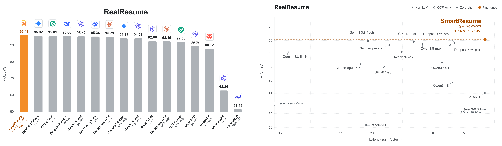
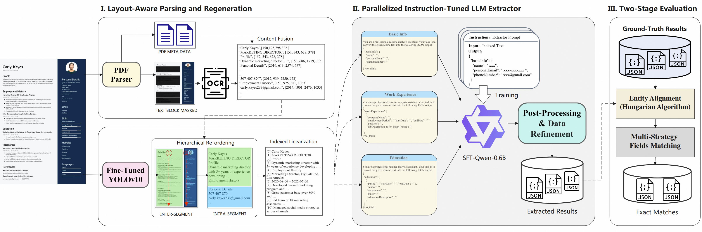

<div align="center">


<h1>SmartResume</h1>

Layout-aware parsing · Source text recovery by index · Structured JSON

**Read complex resumes. Locate source evidence. Extract fields in parallel.**

[🌐 Online Demo](https://modelscope.cn/studios/Alibaba-EI/SmartResumeDemo?mode=full) · [📊 Benchmark Results](#benchmark-results) · [❓ FAQ](docs/FAQ.md)

[](https://github.com/alibaba/SmartResume)
[](https://www.modelscope.cn/models/Alibaba-EI/SmartResume)
[](https://arxiv.org/abs/2510.09722)
[](LICENSE)

**English** · [简体中文](README_CN.md)

</div>

SmartResume converts PDF, image, and common Office resumes into structured information for recruitment workflows. It combines native PDF text with OCR, reconstructs reading order from page layout, and uses indexed source text for LLM extraction.

The system supports **10 extraction task families**, covering personal information, work, projects, education, skills and strengths, publications, competitions, honors, research directions, and social profiles. Use a local model or a remote API through the CLI, Python API, or web demo.

<a id="benchmark-results"></a>

## Benchmark results

On RealResume, SmartResume (Qwen3-0.6B-SFT) achieved the highest macro-averaged accuracy (M-Acc) across all 16 configurations at **96.13%**. Its runtime of **1.54 seconds** tied with zero-shot Qwen3-0.6B for the fastest time.

[](assets/realresume-benchmark.png)

Overall scores for SynthResume and RealResume, field-level results, and cross-lingual evaluations are available in the [full benchmark results](docs/benchmark-results-en.md).

## Why SmartResume?

- **📄 PDF and OCR working together.** Read native PDF text and use OCR to recover additional content from document images.
- **🧭 Layout-aware reading order.** Group and reorder text by detected page regions, then assign indices to the resulting text.
- **🔗 Source-grounded long descriptions.** Extract short fields directly; recover work and project descriptions from model-selected source ranges.
- **⚡ Parallel field extraction.** Dispatch selected extraction tasks concurrently and merge their results into a common JSON structure.
- **🧩 Broad field coverage and flexible deployment.** Select from 10 task families and connect either a local model or a remote API. See [Output format](docs/zh/reference/output_format.md) for field details.

## Parsing demo

<div align="center">
<video width="640" height="360" controls>
  <source src="./assets/SmartResume.mp4" type="video/mp4">
  Your browser does not support HTML5 video.
</video>
</div>

Use the [🌐 SmartResume online demo](https://modelscope.cn/studios/Alibaba-EI/SmartResumeDemo?mode=full) to upload a resume, inspect the extracted sections, and export structured JSON. For local use, start the [web service](#web-demo).

## How it works

SmartResume combines native PDF text with OCR results and reconstructs reading order through layout analysis to create indexed text. The LLM extracts fields in parallel: short values are returned directly, while long descriptions are located by index and recovered from the source text. Fields are then normalized and task results merged into structured JSON with the original text in `rawText`.

<p align="center">
  
</p>

<a id="quick-start"></a>

## Quick Start

### Requirements

- Python 3.10+; Python 3.11 is recommended.
- Linux x86_64, an NVIDIA GPU, and a CUDA 12.4-compatible driver. The steps below use GPU acceleration and a local model by default.

### Installation

1. **Clone the repository**

~~~bash
git clone https://github.com/alibaba/SmartResume.git
cd SmartResume
~~~

2. **Create a conda environment**

~~~bash
conda create -n resume_parsing python=3.11 -y
conda activate resume_parsing
~~~

3. **Install dependencies**

Install GPU inference, local-model and Web dependencies together:

~~~bash
pip install -e .
~~~

For upgrading an older environment, CPU execution or system libraries, see [Runtime installation](docs/runtime-installation.md). Container users can follow [Docker deployment](docs/runtime-installation.md#docker).

4. **Configure the environment and download models**

~~~bash
cp -n configs/config.yaml.example configs/config.yaml
python scripts/download_models.py
~~~

The default configuration uses a local model. Settings are stored in `configs/config.yaml`; existing configurations and models can be reused. See [Local model deployment](docs/local-models.md) for model paths and deployment options.

### Basic Usage

#### Method 1: Command Line Interface (Recommended)

Parse a resume, extract all ten task families by default, and print the JSON result:

~~~bash
python scripts/start.py --file resume.pdf
~~~

Use `--extract_types` to select specific tasks. The full command for all task families is:

~~~bash
python scripts/start.py --file resume.pdf \
  --extract_types basic_info work_experience project_experience education \
  skills_strengths publication competition honor research_direction social_profile
~~~

#### Method 2: Python API

Parse a resume and save the result as a JSON file:

~~~python
import json
from pathlib import Path

from smartresume import ResumeAnalyzer
from smartresume.utils.extraction_schema import EXTRACT_TYPES

analyzer = ResumeAnalyzer(init_ocr=True, init_llm=True)
result = analyzer.pipeline(
    cv_path="resume.pdf",
    resume_id="resume_001",
    extract_types=list(EXTRACT_TYPES),
)
if "error" in result:
    raise RuntimeError(result["error"])
Path("result.json").write_text(
    json.dumps(result, ensure_ascii=False, indent=2), encoding="utf-8"
)
~~~

CLI output includes logs; use the API above to save a pure JSON file. Reuse the same `analyzer` for batch processing; see the [API guide](docs/zh/usage/api.md) for examples.

<a id="web-demo"></a>

#### Web Service (Recommended for Repeated Use)

~~~bash
python demo/web_app.py
~~~

Open `http://localhost:4999` in your browser to upload a resume and view the results. The web service reuses the loaded models.

## Documentation

| Topic | Guide |
| --- | --- |
| Installation, CPU/GPU, and Docker | [Runtime installation](docs/runtime-installation.md) |
| Local model deployment | [Local models](docs/local-models.md) |
| Remote API and runtime settings | [Configuration](docs/configuration.md) |
| PDF processing | [PDF processing](docs/pdf-processing.md) |
| Output fields | [JSON schema](docs/zh/reference/output_format.md) |
| Questions and troubleshooting | [FAQ](docs/FAQ.md) |
| Full experimental results | [Benchmarks](docs/benchmark-results-en.md) |

## License and implementation notes

The source code is released under the [Apache License 2.0](LICENSE). Consult the respective licenses of model weights and third-party dependencies.

This repository is a refactored open-source implementation. Internal PDF parsing and OCR components were replaced with open-source alternatives, so behavior may differ from the original research system.

## Acknowledgments

- [PDFplumber](https://github.com/jsvine/pdfplumber)
- [RapidOCR](https://github.com/RapidAI/RapidOCR)

## Citation

```bibtex
@article{Zhu2025SmartResume,
  title={Layout-Aware Parsing Meets Efficient LLMs: A Unified, Scalable Framework for Resume Information Extraction and Evaluation},
  author={Fanwei Zhu and Jinke Yu and Zulong Chen and Ying Zhou and Junhao Ji and Zhibo Yang and Yuxue Zhang and Haoyuan Hu and Zhenghao Liu},
  journal={arXiv preprint arXiv:2510.09722},
  year={2025},
  url={https://arxiv.org/abs/2510.09722}
}
```

---

If SmartResume helps your work, consider giving the project a ⭐ on [GitHub](https://github.com/alibaba/SmartResume).
