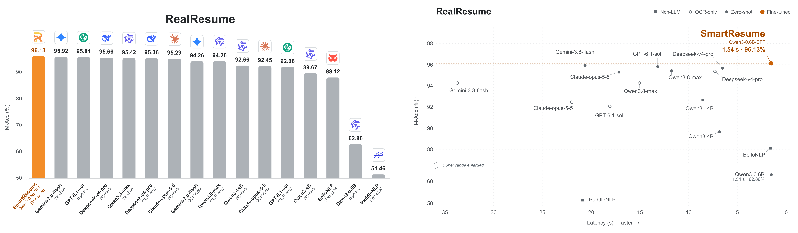
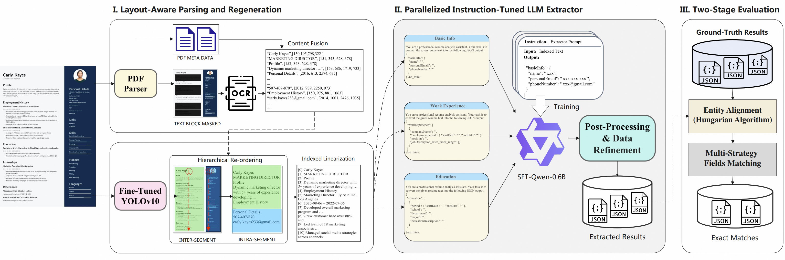

<div align="center">


<h1>SmartResume</h1>

版面感知解析 · 原文索引回填 · 结构化 JSON

**读懂复杂简历，定位原文依据，并行提取信息。**

[🌐 在线体验](https://modelscope.cn/studios/Alibaba-EI/SmartResumeDemo?mode=full) · [📊 基准结果](#benchmark-results) · [❓ 常见问题](docs/zh/reference/faq.md)

[](https://github.com/alibaba/SmartResume)
[](https://www.modelscope.cn/models/Alibaba-EI/SmartResume)
[](https://arxiv.org/abs/2510.09722)
[](LICENSE)

[English](README.md) · **简体中文**

</div>

SmartResume 面向招聘场景，将 PDF、图片及常见 Office 格式的简历转换为结构化信息。系统融合 PDF 原生文本与 OCR，结合版面检测重建阅读顺序，再基于带索引的原文进行 LLM 字段抽取。

系统支持 **10 类抽取任务**，涵盖个人信息、工作经历、项目经历、教育经历、技能优势、论文、竞赛、荣誉、研究方向和社会主页。可通过命令行、Python API 或网页 Demo 使用，并支持本地模型和远程 API。

<a id="benchmark-results"></a>

## 📊 基准结果

在 RealResume 的 16 组评测配置中，SmartResume（Qwen3-0.6B-SFT）的宏平均准确率（M-Acc）最高，为 **96.13%**。耗时为 **1.54 秒**，与零样本 Qwen3-0.6B 并列最短。

[](assets/realresume-benchmark.png)

SynthResume 与 RealResume 的完整指标、细分字段结果及跨语言评测见[基准测试结果](docs/benchmark-results-zh.md)。

## 💡 为什么选择 SmartResume？

- **📄 PDF 与 OCR 混合解析。** 读取 PDF 原生文本，通过 OCR 补充文档图像中的其他文字内容。
- **🧭 结合版面重建阅读顺序。** 按检测到的页面区域组织和排序文本，为后续抽取构建带 Index 的文本。
- **🔗 长描述从原文回填。** 短字段直接抽取；工作与项目描述通过模型定位索引区间，再恢复对应原文。
- **⚡ 多任务并行抽取。** 并发处理选定的字段任务，汇总为统一的 JSON 结构。
- **🧩 字段覆盖广，部署方式灵活。** 支持按需选择 10 类任务，也可对接本地模型或远程 API，字段详情见 [输出格式](docs/zh/reference/output_format.md)。


## 🎬 解析效果展示

<div align="center">
<video width="640" height="360" controls>
  <source src="./assets/SmartResume.mp4" type="video/mp4">
  您的浏览器不支持 HTML5 视频。
</video>
</div>

在[🌐 SmartResume在线体验](https://modelscope.cn/studios/Alibaba-EI/SmartResumeDemo?mode=full)
上传简历、查看各模块的抽取结果，并导出结构化 JSON。本地体验可启动下方的 [Web 服务](#web-demo)。

## ⚙️ 工作原理

SmartResume融合 PDF 原生文本与 OCR 识别结果，结合版面分析重建阅读顺序，生成带 Index 的文本。LLM 按任务并行抽取字段，短文本直接输出，长描述通过索引定位并从原文回填。经过字段归一化与结果汇总，输出结构化 JSON 和原文 rawText。

<p align="center">
  
</p>


<a id="quick-start"></a>

## 🚀 快速开始

### 🖥️ 环境要求

- Python 3.10+，推荐使用 Python 3.11。
- Linux x86_64、NVIDIA GPU，以及兼容 CUDA 12.4 的驱动。以下步骤默认使用 GPU 和本地模型。

### 📦 安装步骤

1. **克隆项目**

~~~bash
git clone https://github.com/alibaba/SmartResume.git
cd SmartResume
~~~

2. **创建 conda 环境**

~~~bash
conda create -n resume_parsing python=3.11 -y
conda activate resume_parsing
~~~

3. **安装依赖**

默认安装 GPU 推理、本地模型和 Web 所需依赖：

~~~bash
pip install -e .
~~~

旧环境升级、CPU 运行及系统库说明见 [运行环境说明](docs/runtime-installation.md)；容器部署见 [Docker 部署](docs/zh/quick_start/docker.md)。

4. **配置环境并下载模型**

~~~bash
cp -n configs/config.yaml.example configs/config.yaml
python scripts/download_models.py
~~~

默认使用本地模型，配置文件为 `configs/config.yaml`。已有配置和模型可直接复用；模型路径与部署方式详见 [本地模型部署](docs/zh/usage/local_models.md)。

### 🛠️ 基本使用

#### ⌨️ 方法 1：使用命令行界面（推荐）

解析单个简历，默认抽取全部 10 类信息并输出 JSON：

~~~bash
python scripts/start.py --file resume.pdf
~~~

也可以通过 `--extract_types` 指定需要抽取的条目。全部类型的完整调用命令如下：

~~~bash
python scripts/start.py --file resume.pdf \
  --extract_types basic_info work_experience project_experience education \
  skills_strengths publication competition honor research_direction social_profile
~~~

#### 🐍 方法 2：使用 Python API

解析简历并保存为 JSON 文件：

~~~python
import json
from pathlib import Path

from smartresume import ResumeAnalyzer
from smartresume.utils.extraction_schema import EXTRACT_TYPES

analyzer = ResumeAnalyzer(init_ocr=True, init_llm=True)
result = analyzer.pipeline(
    cv_path="resume.pdf",
    resume_id="resume_001",
    extract_types=list(EXTRACT_TYPES),
)
if "error" in result:
    raise RuntimeError(result["error"])
Path("result.json").write_text(
    json.dumps(result, ensure_ascii=False, indent=2), encoding="utf-8"
)
~~~

命令行输出包含日志，需要保存纯 JSON 时使用上述 API。批量处理时复用同一个 `analyzer`，示例见 [API 使用指南](docs/zh/usage/api.md)。

<a id="web-demo"></a>

#### 🌐 Web 服务（推荐多次调用）

~~~bash
python demo/web_app.py
~~~

在浏览器中访问 `http://localhost:4999`，上传简历并查看解析结果。Web 服务会复用已加载的模型。

## 📚 使用文档

| 主题 | 文档 |
| --- | --- |
| 安装、CPU/GPU 与 Docker | [运行环境说明](docs/runtime-installation.md) |
| 本地模型部署 | [本地模型](docs/zh/usage/local_models.md) |
| 远程 API 与运行配置 | [配置指南](docs/zh/usage/configuration.md) |
| PDF 处理流程 | [PDF 处理说明](docs/pdf-processing.md) |
| 输出字段 | [JSON 输出格式](docs/zh/reference/output_format.md) |
| 常见问题与排查 | [FAQ](docs/zh/reference/faq.md) |
| 完整实验结果 | [基准测试](docs/benchmark-results-zh.md) |

## ⚖️ 许可与实现说明

项目源代码采用 [Apache License 2.0](LICENSE)。模型权重与第三方依赖的许可请参阅各自说明。本仓库为重构后的开源实现。内部 PDF 解析和 OCR 组件已使用开源方案替代，部分行为可能与原始研究系统不同。

## 🤝 致谢

- [PDFplumber](https://github.com/jsvine/pdfplumber)
- [RapidOCR](https://github.com/RapidAI/RapidOCR)

## 🔖 引用

```bibtex
@article{Zhu2025SmartResume,
  title={Layout-Aware Parsing Meets Efficient LLMs: A Unified, Scalable Framework for Resume Information Extraction and Evaluation},
  author={Fanwei Zhu and Jinke Yu and Zulong Chen and Ying Zhou and Junhao Ji and Zhibo Yang and Yuxue Zhang and Haoyuan Hu and Zhenghao Liu},
  journal={arXiv preprint arXiv:2510.09722},
  year={2025},
  url={https://arxiv.org/abs/2510.09722}
}
```

---

如果 SmartResume 对你有帮助，欢迎在 [GitHub](https://github.com/alibaba/SmartResume) 点亮 ⭐。
